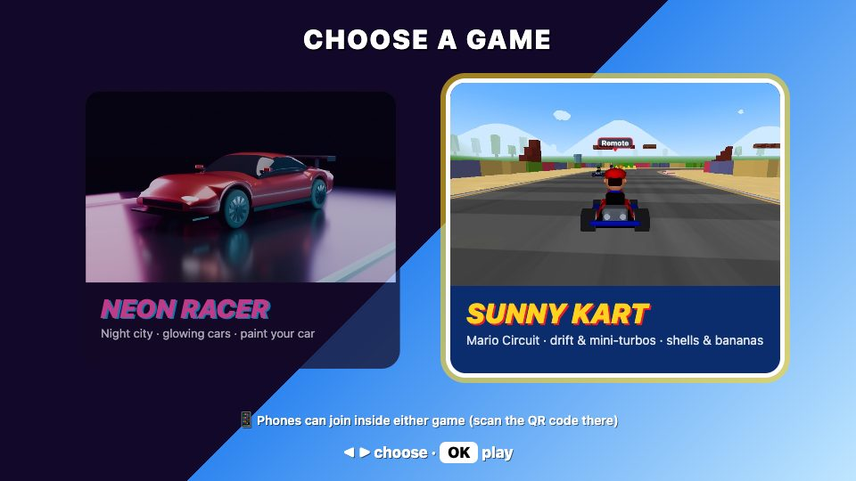
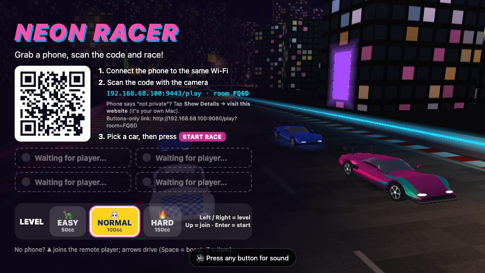
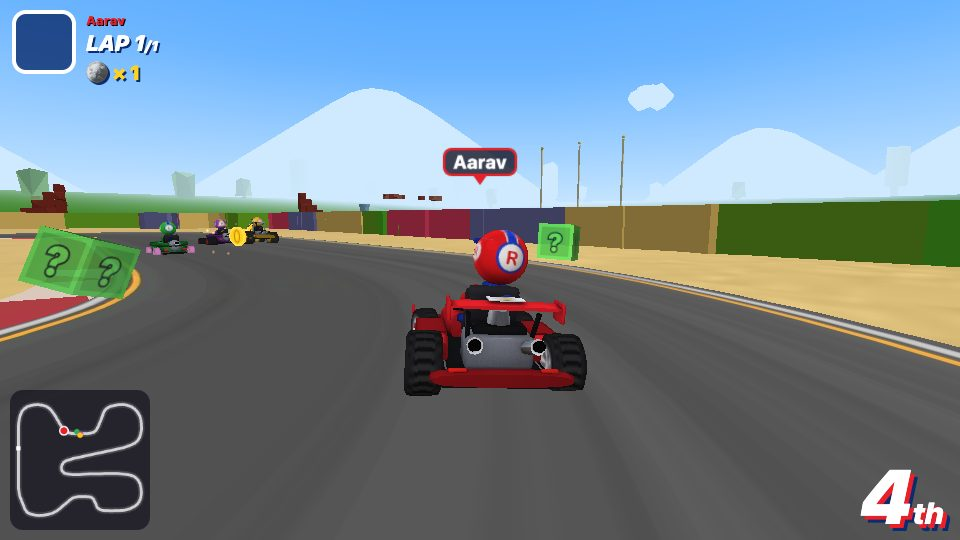
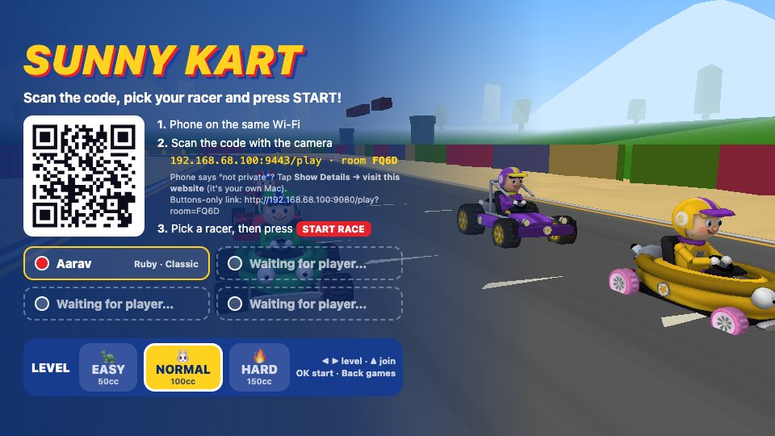
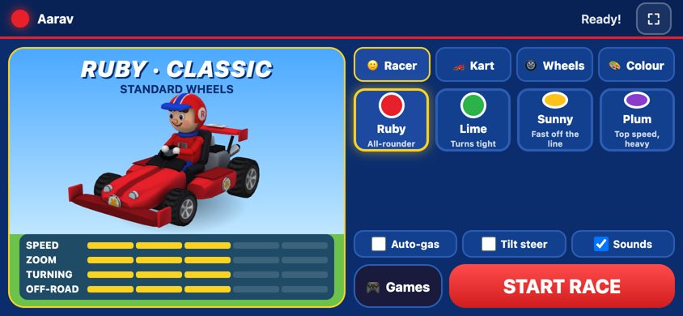
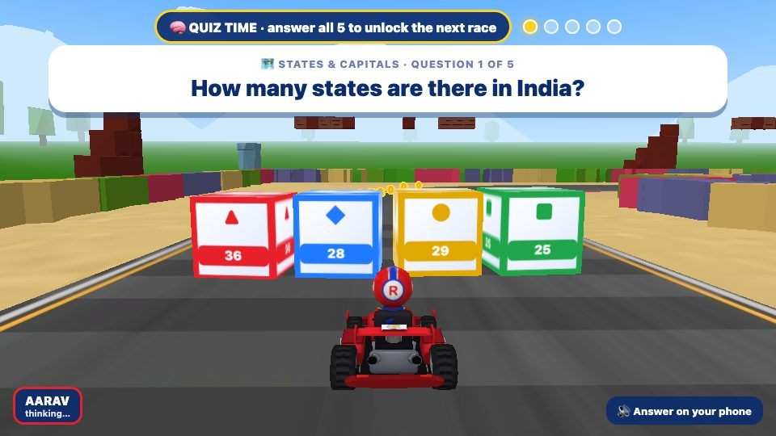

# 🏎️ Kid Racer: Neon Racer + Sunny Kart

Racing games for the **TV**, played with **phones as controllers**, like AirConsole.
The race runs in the TV's web browser; each player scans a QR code with their phone and uses it as a gamepad.
Nothing is installed on the TV or the phones: one computer at home runs a small server, and everything else
happens in web browsers on your home Wi-Fi.



| Neon Racer | Sunny Kart |
|---|---|
|  |  |
| Night-city racing: glowing cars you paint yourself, boost pads, items. | Kart racing in the style of Mario Kart: drifts and mini-turbos, shells and bananas, 4 racers, karts you build. |

**Also included**
- 🧠 **After-race quiz:** 5 general-knowledge questions (read aloud) after every race; the next race unlocks once they're answered.
- 🐢🐰🔥 **Difficulty levels:** Easy, Normal or Hard, chosen in the lobby.
- 1–4 players. Computer racers fill the empty places.

---

## What you need

| | Requirement |
|---|---|
| 💻 **A computer** | Mac, Windows or Linux, on your home Wi-Fi (Wi-Fi or a network cable both work). It runs the game server and must stay **on and awake** while you play. |
| 📺 **A TV with a web browser** | A smart TV (Android TV / Google TV / Fire TV, or a TV browser app) on the **same home network**. A laptop connected to the TV with HDMI also works. |
| 📱 **Phones** | One per player, on the **same Wi-Fi**. Any recent iPhone or Android phone with a camera to scan the QR code. |
| 🌐 **Internet** | Only for the one-time download and install. Playing works on the home network alone. |

> **Same network matters.** The TV, the phones and the computer must all be on the same home Wi-Fi.
> A **guest network** usually blocks devices from seeing each other, so don't use it.

---

## Setup (once, about 10 minutes)

### Step 1: Install Node.js on the computer

Node.js runs the game server.

1. Go to **https://nodejs.org** and download the **LTS** version (version 20 or newer).
2. Run the installer and accept the defaults.
3. Check it worked. Open a terminal:
   - **Mac:** press <kbd>⌘ Cmd</kbd> + <kbd>Space</kbd>, type `Terminal`, press <kbd>Enter</kbd>.
   - **Windows:** press the <kbd>⊞ Windows</kbd> key, type `PowerShell`, press <kbd>Enter</kbd>.

   Then type the following and press <kbd>Enter</kbd>:
   ```
   node --version
   ```
   You should see something like `v22.11.0`. If you get "command not found", restart the computer and try again.

### Step 2: Download the game

**Easiest:** on this GitHub page, click the green **`<> Code`** button → **Download ZIP**.
Unzip it somewhere easy to find, for example your **Documents** folder. You'll get a folder called `kid-racer`
(it may be called `kid-racer-main`; that's fine).

**Or, with git:**
```
git clone <this repository's URL>
```

### Step 3: Install the game's parts

In the terminal, go into the game folder, then install. Replace the path below with where you unzipped it.

**Mac:**
```
cd ~/Documents/kid-racer
npm install
```

**Windows (PowerShell):**
```
cd $HOME\Documents\kid-racer
npm install
```

> 💡 **Tip:** type `cd ` (with a space), then **drag the folder** from Finder or File Explorer into the terminal window.
> The path is filled in for you. Press <kbd>Enter</kbd>.

`npm install` downloads a few libraries (three.js, ws and qrcode, about 30 MB) and takes a minute. You only do this once.

---

## Playing

### 1. Start the server on the computer

In the terminal, inside the game folder:
```
npm start
```

You'll see something like:
```
  Neon Racer is running!
  TV screen : http://localhost:8080   (or http://192.168.1.20:8080 from the TV browser)
  Phones    : https://192.168.1.20:8443/play  (scan the QR code on the TV)
```

**Write down the `http://192.168.x.x:8080` address**; your numbers will be different. That's the address for the TV.

> **The first time**, the computer may ask about the network:
> - **Mac:** "Do you want the application node to accept incoming network connections?" → **Allow**.
> - **Windows:** a Windows Defender Firewall window → tick **Private networks** → **Allow access**.
>
> If you click "Cancel" or "Block" by mistake, see [Troubleshooting](#troubleshooting).

Leave the terminal window open while you play. To stop the server, click the terminal and press <kbd>Ctrl</kbd> + <kbd>C</kbd>.

### 2. Open the game on the TV

1. Open the TV's **web browser**.
2. Type the address from step 1, for example `http://192.168.1.20:8080`. Make sure you include `http://` and `:8080`.
3. **Bookmark it** so next time it's one click.
4. You'll see the start screen. Use the remote's **◀ ▶** to choose **Neon Racer** or **Sunny Kart**, then press **OK**.

### 3. Join with the phones



1. Open the **camera** on the phone and point it at the **QR code** on the TV, then tap the link that pops up.
2. **The phone will say the connection is "not private" or "not secure". That's expected:** the game runs on your own
   computer, not on a website. To continue:
   - **iPhone (Safari):** tap **Show Details** → **visit this website** → **Visit Website**.
   - **Android (Chrome):** tap **Advanced** → **Proceed to 192.168.x.x (unsafe)**.

   You only do this once per phone. (This secure link is what allows steering by **tilting** the phone. Under the
   QR code there's also a plain `http://` link that skips the warning, but tilt steering won't work with it.)
3. Type a name, tap **JOIN**, pick your racer or car, then tap **START RACE**.



### Controls

**On the phone:** the thumbstick on the left steers. On the right: **GO** (gas), **REVERSE**, **ITEM** and **HOP/DRIFT**
(Sunny Kart). Turn on **Auto-gas** for little ones, or **Tilt steer** to steer by tilting the phone.

**On the TV remote:**

| Where | Button | What it does |
|---|---|---|
| Start screen | ◀ ▶, OK | choose a game, start it |
| Lobby | ◀ ▶ | change the difficulty level |
| Lobby | ▲ | add a "Remote" player who drives with the remote's arrows |
| Lobby / results | OK | start the race / play again |
| Lobby / results | Back | go back to the start screen |
| During the quiz | ◀ ▶, OK | choose an answer (if a remote player raced) |

**After every race** there's a 5-question quiz on the TV, answered on the phones. The next race unlocks when everyone
has answered.



---

## Every time after that

1. On the computer: open the terminal, go into the folder (`cd …`), and run `npm start`.
2. On the TV: open the bookmark.
3. Phones: scan the QR code. Phones that played before can also reopen the last link.

> 🔊 **No sound?** Press any button on the TV remote once. Some TV browsers only allow sound after a button press.

---

## Troubleshooting

<details>
<summary><b>The TV says "can't reach this page" or keeps loading</b></summary>

- Is `npm start` still running on the computer? The terminal window must stay open, and the computer must be awake
  (turn off sleep while playing).
- Check the address: it must start with `http://` (not `https://`) and end with `:8080`.
- Is the TV on the **same network** as the computer? Not the guest network, and not a different Wi-Fi such as a
  "5G" network or an extender with its own name, if your router keeps those separate.
- Firewall: you may have blocked Node.js the first time.
  - **Mac:** System Settings → Network → Firewall → Options → find `node` → set it to **Allow incoming connections**.
  - **Windows:** Start → "Allow an app through Windows Firewall" → **Change settings** → tick **Node.js** for **Private**.
    Also check that your Wi-Fi is set to a **Private** network (Settings → Network & internet → Wi-Fi → your network → Private).
</details>

<details>
<summary><b>The address the server printed doesn't work (VPN, several network adapters)</b></summary>

Some computers have extra network adapters (VPN, Docker, virtual machines), and the server may print the wrong one.

1. Find the computer's real home-network address:
   - **Mac:** System Settings → Wi-Fi → Details → **IP address**.
   - **Windows:** in PowerShell run `ipconfig` and look for **IPv4 Address** under your Wi-Fi adapter.

   It usually starts with `192.168.` or `10.`.
2. Start the server with that address, replacing `192.168.1.20` with yours:
   - **Mac / Linux:** `HOST_IP=192.168.1.20 npm start`
   - **Windows (PowerShell):** `$env:HOST_IP="192.168.1.20"; npm start`

The QR code on the TV will then point to the right place. Also try turning off a VPN while playing.
</details>

<details>
<summary><b>The phone can't connect after scanning the QR code</b></summary>

- Is the phone on the **home Wi-Fi**, and not using mobile data? Turn Wi-Fi on. On iPhone, also turn off
  *Settings → Mobile Data → Wi-Fi Assist* if pages keep failing.
- Did you get past the "not private" warning? See step 3 above. Or use the plain `http://` link shown under the QR code.
- **Android with the error `ERR_TOO_MANY_RETRIES` or a page that never loads:** Chrome needs permission to reach devices
  at home. Go to Settings → Apps → Chrome → Permissions → **Nearby devices** → **Allow**.
- An ad-blocker or VPN app on the phone can also block it. Pause it.
</details>

<details>
<summary><b>"Port already in use" / <code>EADDRINUSE</code> when starting</b></summary>

The game is probably already running in another terminal window. Close that window or press <kbd>Ctrl</kbd> + <kbd>C</kbd> in it.
Or use different ports:
- **Mac / Linux:** `PORT=9080 HTTPS_PORT=9443 npm start`
- **Windows (PowerShell):** `$env:PORT=9080; $env:HTTPS_PORT=9443; npm start`

Then the TV address ends with `:9080` instead of `:8080`.
</details>

<details>
<summary><b>Windows: the server says it couldn't create an https certificate</b></summary>

The secure phone link needs the `openssl` tool, which Windows doesn't always have. The game still works: phones use
the plain `http://` link (buttons work; only tilt steering doesn't). To get tilt steering, install
**Git for Windows** (https://git-scm.com), which includes openssl, then start the server from **Git Bash** instead of PowerShell.
</details>

<details>
<summary><b>The game is slow or jerky on the TV</b></summary>

The games are made to run on modest smart-TV hardware, but very old or very cheap TVs can struggle. Try:
- **Neon Racer** instead of Sunny Kart; it's lighter.
- Closing other apps on the TV, or restarting the TV.
- A cheap streaming stick (Fire TV Stick, Chromecast with Google TV) or a laptop on HDMI usually runs it smoothly.
</details>

<details>
<summary><b>Two TVs in the same home?</b></summary>

That works: each TV screen gets its own room code (shown under its QR code), and phones join the TV whose QR code
they scanned. Each TV needs its own players.
</details>

---

## For the curious

- **How it works:** the computer runs `server/index.js` (Node.js), which serves the web pages and relays the phone
  buttons to the TV over WebSockets. The TV runs the whole race in the browser with [three.js](https://threejs.org).
  The phones only send button presses.
- **What's stored:** nothing leaves your home network while playing. Settings (names, cars, difficulty, which quiz
  questions were asked) are kept in each browser's local storage.
- **Developer notes:** see [DEVELOPMENT.md](DEVELOPMENT.md).

## Credits

- 3D: [three.js](https://threejs.org) (MIT). Cars, karts, drivers, items and the Neon Racer track were made for this project in Blender.
- Voices, sound effects and music generated with [ElevenLabs](https://elevenlabs.io).
- Quiz questions: a general-knowledge practice set for Class 3 (SKGKO-style), written for this project.
- Sunny Kart's track is based on a fan-made, Mario Kart-inspired project. Kid Racer is a non-commercial family project
  and is not affiliated with or endorsed by Nintendo.
